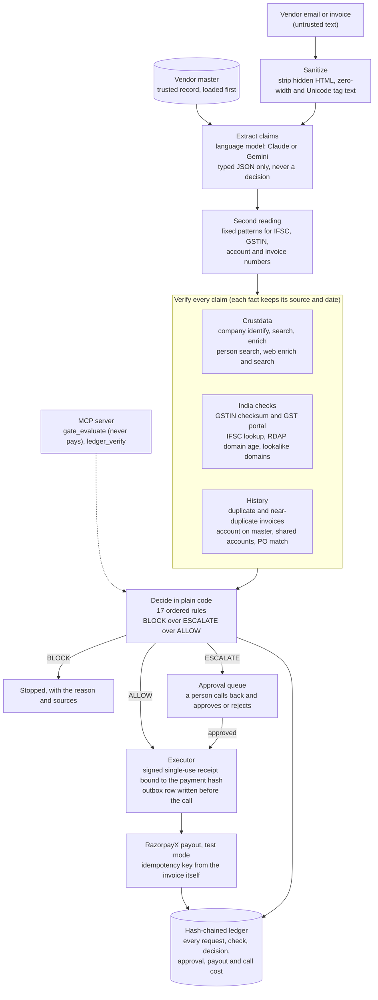

# How the Payables Sign-Off Gate is built

## Where things live

| Part | Code | Runs on |
|---|---|---|
| Sanitize, extract, second reading | `gate/sanitize.py`, `gate/extractor.py`, `gate/llm_gemini.py`, `gate/crosscheck.py` | Python 3.14. Claude API or Gemini API (free tier) |
| Checks | `gate/verifiers/` (Crustdata, India, history) | Crustdata API, ifsc.razorpay.com, RDAP registries, GST portal |
| Policy | `gate/policy.py` | Plain Python, no model |
| State | `gate/store.py`, `gate/ledger.py` | SQLite in WAL mode (`runs/gate.sqlite`): vendors, requests, decisions, approvals, outbox, payouts, calls, ledger |
| Payments | `gate/executor.py`, `gate/payments/razorpayx.py` | RazorpayX Payouts API in test mode, or a mock provider with the same rules |
| Call costs | `gate/runbudget.py` | Every external call is logged with its credits and tokens, under a per-run ceiling |
| Screens | `app/approvals.py`, `streamlit_app.py` | Streamlit |
| Agent access | `mcp_server/server.py` | MCP (stdio) |

## Where Crustdata is called

| Question | Endpoint |
|---|---|
| Is the sender's domain this vendor's domain? | `/company/identify`, `/company/search` |
| Is the vendor still operating, and is there recent news? | `/company/enrich`, `/web/search/live`, `/web/enrich/live` |
| Does the requester work at the vendor today, in that role? Did they leave? | `/person/search`, filtered by the vendor's company id |
| Who holds that role now (for the callback)? | `/person/search` |

Calls are cached on disk, keyed by the request, so a repeated check costs nothing. Crustdata allows 5 searches a minute, which the client respects.
